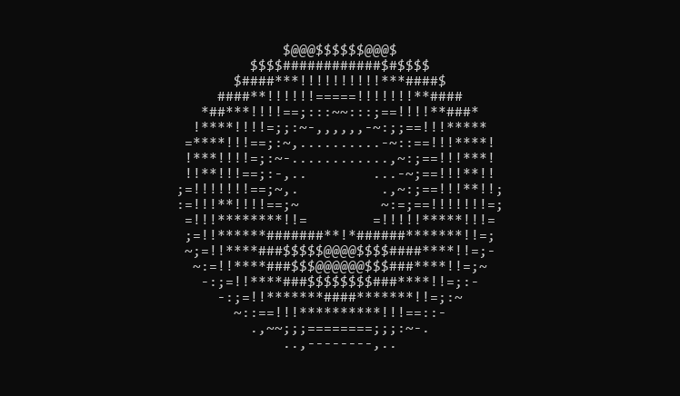
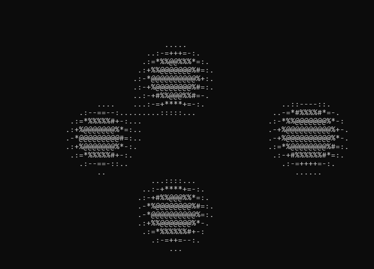
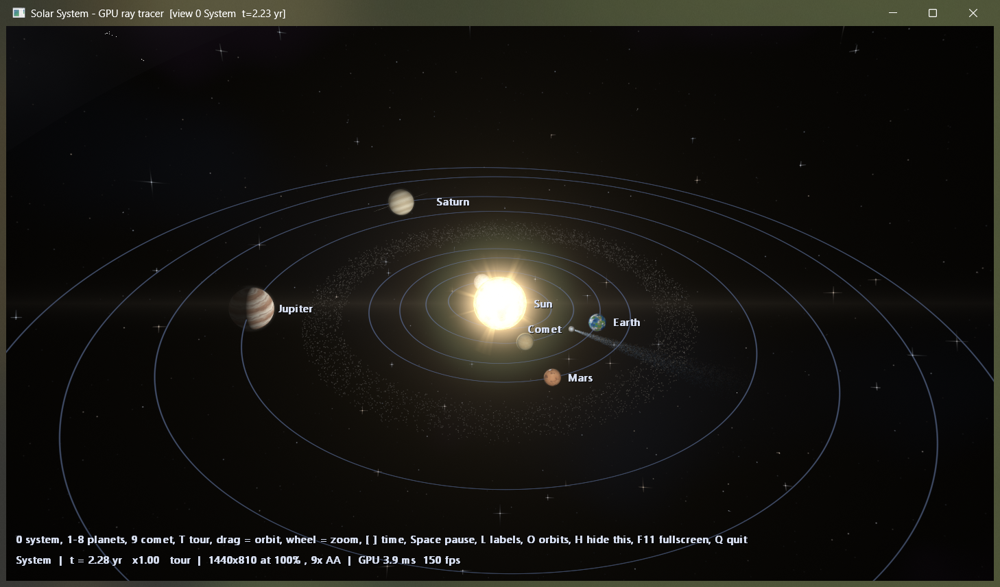
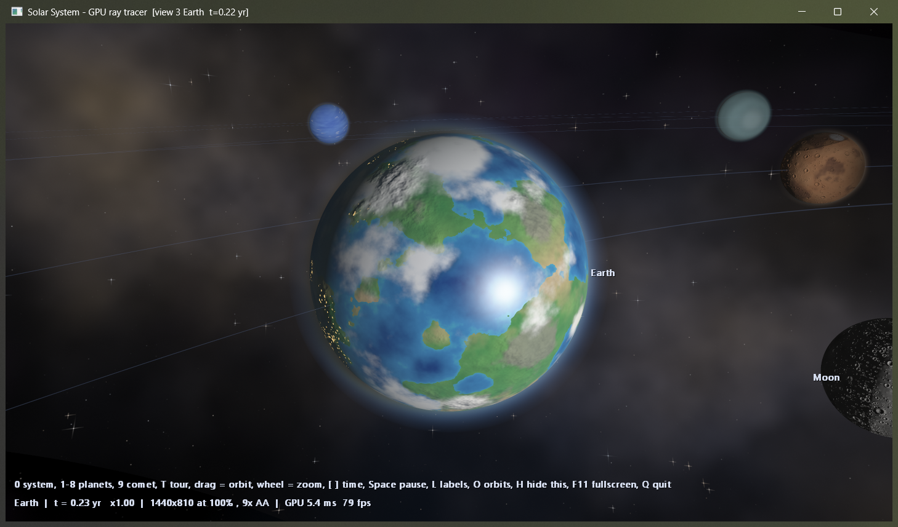
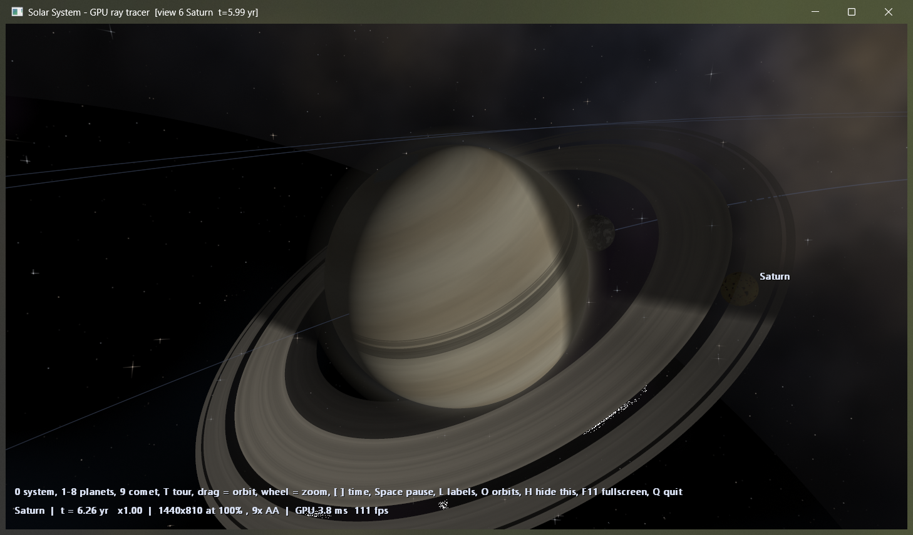
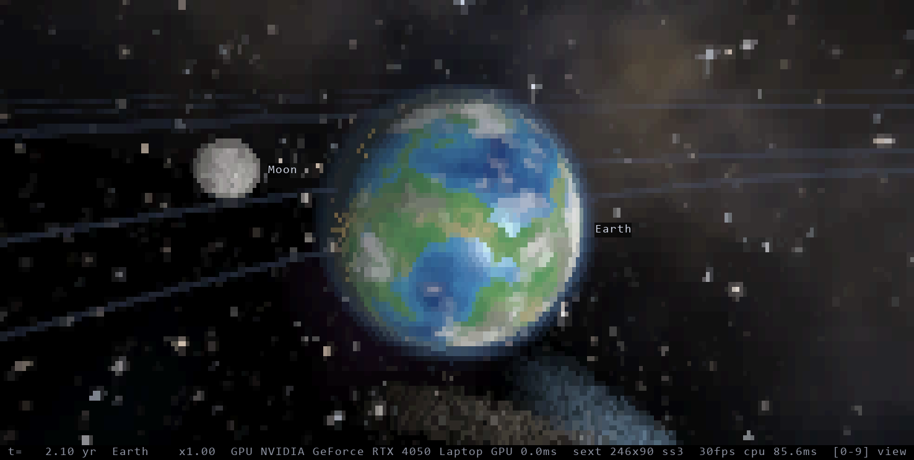

# ascii-terminal

<p align="center">
  
</p>

Terminal animations for Windows drawn with ANSI escapes, plus a GPU-rendered 3D solar system.

- **donut** - spinning 3D torus. Python and C versions, same math.
- **badapple** - ASCII video player in C. Fits to the console size, re-centers on resize, syncs to wav audio, loops.
- **solar system** - a 3D solar system in three generations, up to a Direct3D 11 compute-shader ray tracer that runs in a terminal or in a native window. See [solar system](#solar-system).

## donut

```
python donut.py
```

```
cl /O2 /W4 /nologo donut.c
donut.exe
```

Spin speed and frame delay are constants at the top of each file. Ctrl+C exits.

## badapple

<p align="center">
  
</p>

The player plays any 120x90 gray frame file. No video needed to try it - `demo.py` writes an original looping animation:

```
python demo.py
cl /O2 /W4 /nologo badapple.c winmm.lib
badapple.exe demo.gray
```

To play a video, bring your own copy and convert it once (needs `ffmpeg` on PATH). No video or audio is included in this repo:

```
powershell -File prep.ps1 -Video path\to\bad_apple.mp4
```

That writes `frames.gray` (raw 8-bit gray, 120x90, 30 fps) and `audio.wav`. Then:

```
badapple.exe frames.gray audio.wav
```

`q`, Esc or Ctrl+C quits. Audio is optional - leave out `audio.wav` to play silent.

Config constants at the top of `badapple.c`: `kSrcW`/`kSrcH` (must match the prep size), `kFps`, `kAudioOffsetMs`, `kInvert`, `kLoop`.

Needs Windows Terminal or any console with VT sequence support.

## solar system

<p align="center">
  
</p>
<p align="center">
  
  
</p>

Three versions of the same scene, each one a step up:

| file | what it is |
|---|---|
| `solar.c` | first version: flat top-down view in colored ASCII |
| `solar3d.c` | CPU ray tracer in the terminal: lit and shadowed spheres, Saturn's rings, a comet, Unicode sextant output (2x3 sub-pixels per cell) |
| `solargpu.c` + `solargpu.hlsl` | the same scene ray-traced on the GPU with Direct3D 11 compute shaders. One source, two builds: a **terminal** build and a **native window** build |

The terminal is a grid of character cells, so a terminal build always has a visible pixel size. The window build draws at full resolution with no pixel blocks.

<p align="center">
  
</p>

What the GPU version renders: procedural planet surfaces with bump-mapped relief (craters on the Moon, Mercury, Mars, Callisto; mountains on Earth), ray-marched atmospheric scattering, cloud shadows, soft eclipse shadows, Saturn's ring shadows, Sun corona and prominences, procedural stars and Milky Way, a 3D asteroid belt, a comet on a real Kepler ellipse with an ion and a dust tail, bloom, and an auto tour of every planet. The window build adds extra surface detail as you zoom in, a lens flare, mouse orbit, and dynamic resolution that lowers the render scale if a frame goes over its GPU time budget. Surfaces are procedural, not real maps, and the planets are ray-traced spheres, not meshes. Sizes and distances are artistic; orbital periods are real.

Measured on an RTX 4050 laptop GPU: about 3-5 ms of GPU time per frame in the window build at 1440x810 with 9 samples per pixel.

### build

Needs Windows and the MSVC compiler (`cl`).

```
cl /O2 /W4 /nologo solar.c
cl /O2 /W4 /openmp /nologo solar3d.c
```

The GPU version needs a GPU with Direct3D 11 compute (feature level 11_0), and `solargpu.hlsl` next to the exe. Compiled shaders are cached as `.cso` files beside it; the first run after a shader change takes about a minute to compile.

```
:: terminal build (Windows Terminal: truecolor, UTF-8, sextant glyphs)
cl /O2 /W4 /nologo solargpu.c

:: window build
cl /O2 /W4 /nologo /DWINDOWED /Fosolarwin.obj /Fe:solarwin.exe solargpu.c /link /SUBSYSTEM:WINDOWS /ENTRY:mainCRTStartup
```

### keys

`0` system view, `1`-`8` planets, `9` comet, `t` tour on/off (default on), arrows or `a` `d` `w` `s` orbit the camera, `+` `-` zoom, `[` `]` time speed, space pause, `l` labels, `o` orbit lines, `q` or Esc quit. Terminal build: `m` cycles the sub-pixel mode. Window build: drag with the mouse to orbit, wheel to zoom, F11 fullscreen, `h` hides the on-screen help.
